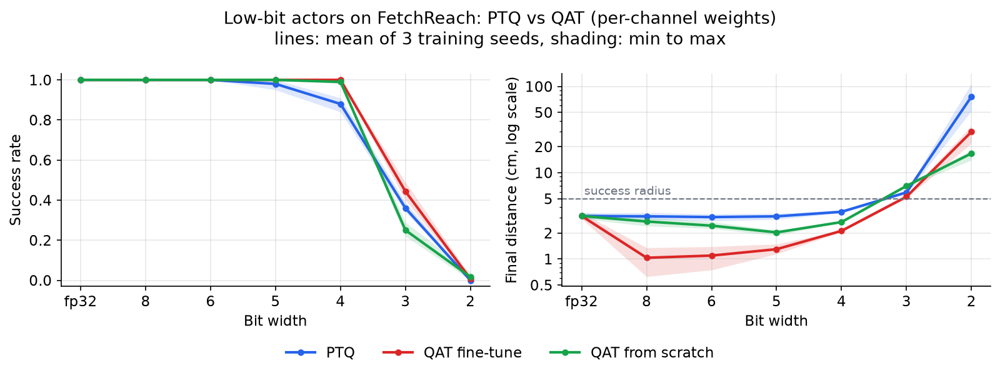
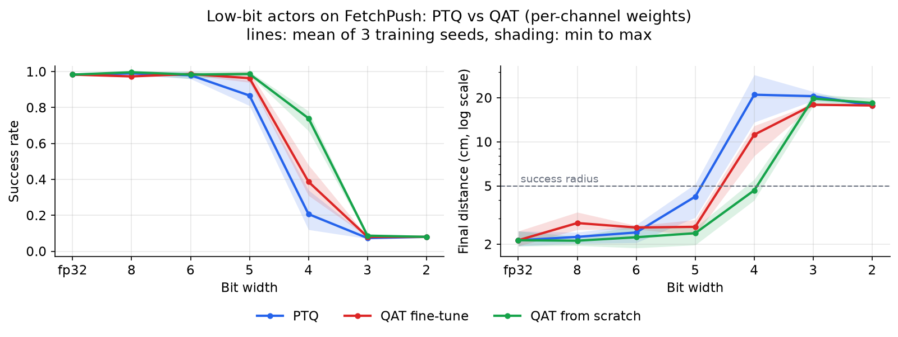
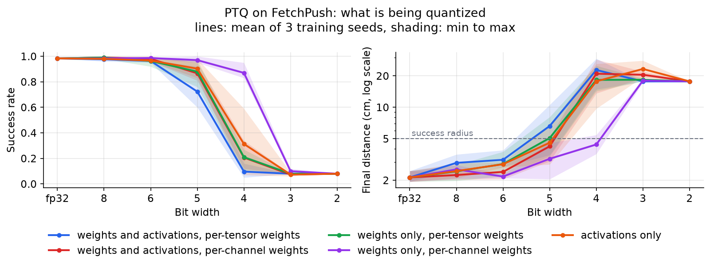
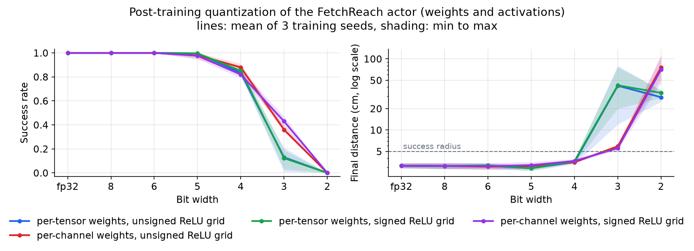
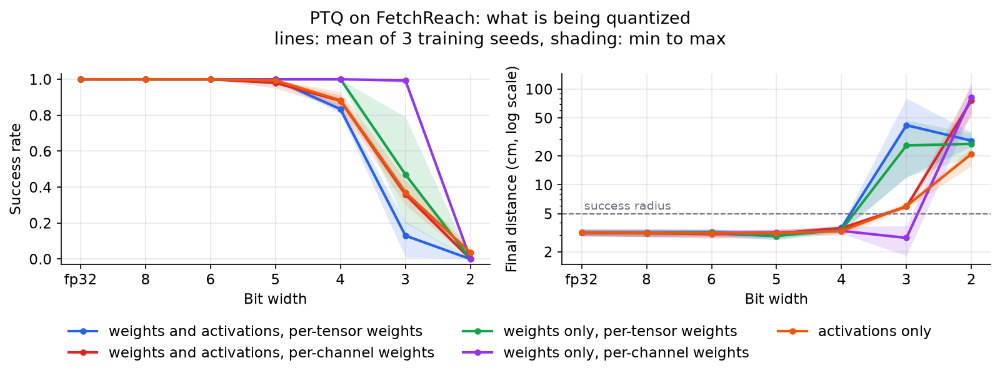
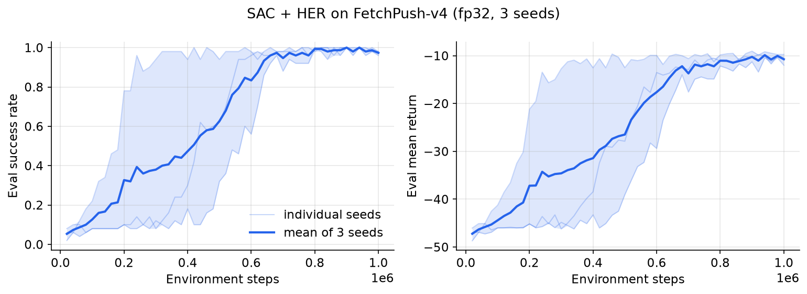
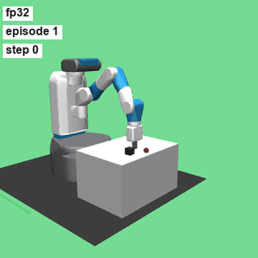
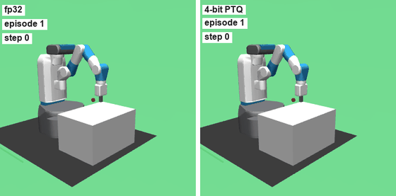
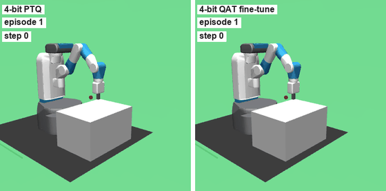
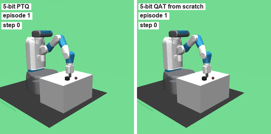

# quantrl-fetch

How few bits does a robot arm policy actually need? This project trains reinforcement learning policies for a simulated Fetch robot arm (MuJoCo, via Gymnasium Robotics) and then squeezes the policy's actor network down to low-bit integer precision: 8 bits, then 6, 5, 4, 3, and 2. It compares three ways of getting a low-bit actor (quantize after training, fine-tune with quantization in the loop, or train with quantization from the start) and later asks whether a post-training stage, behavior cloning followed by online post-training, can win back the performance that quantization costs. The motivation is deployment: a policy that runs on a microcontroller or a small accelerator has to live with low-precision arithmetic, and it is worth knowing where that starts to break a closed-loop controller and what it takes to repair it.

**Status:** Phases 0 to 4 are done: setup, SAC and HER at fp32 on FetchReach and FetchPush, the quantizer, and the comparison of PTQ, QAT fine-tuning, and QAT from scratch on both tasks. Phase 5 (post-training) is next. See [ROADMAP.md](ROADMAP.md).

## Key results

In every table, "N bits" means weights and layer inputs are quantized; biases and the actor's final outputs stay in fp32. Layer inputs that come out of a ReLU use an unsigned grid, and the first layer's input (the normalized observation, which can be negative) uses the symmetric grid. All QAT results below were trained with the straight-through estimator fix described in [docs/DESIGN.md](docs/DESIGN.md) (concerns B and H). How these numbers compare with the earlier ones is summarized at the end of this section.

**Three ways to get a low-bit actor on FetchReach.** Every actor is evaluated on the same 100 episodes. Entries are success rate in percent (mean over 3 training seeds, lowest and highest seed in parentheses) and the mean final distance to the goal. Weights use per-channel scales; weights and activations use the same bit width.

| Bits | PTQ | QAT fine-tune | QAT from scratch |
| --- | --- | --- | --- |
| fp32 | 100.0 (100 to 100), 3.1 cm | 100.0 (100 to 100), 3.1 cm | 100.0 (100 to 100), 3.1 cm |
| 8 | 100.0 (100 to 100), 3.1 cm | 100.0 (100 to 100), 1.0 cm | 100.0 (100 to 100), 2.7 cm |
| 6 | 100.0 (100 to 100), 3.1 cm | 100.0 (100 to 100), 1.1 cm | 100.0 (100 to 100), 2.4 cm |
| 5 | 98.0 (95 to 100), 3.1 cm | 100.0 (100 to 100), 1.3 cm | 100.0 (100 to 100), 2.0 cm |
| 4 | 88.0 (84 to 91), 3.5 cm | 100.0 (100 to 100), 2.1 cm | 99.0 (98 to 100), 2.7 cm |
| 3 | 36.0 (34 to 39), 5.9 cm | 44.3 (40 to 49), 5.3 cm | 25.0 (22 to 29), 7.0 cm |
| 2 | 0.0 (0 to 0), 76.2 cm | 0.7 (0 to 2), 29.8 cm | 1.7 (0 to 4), 16.7 cm |

- **QAT fine-tuning recovers 4 and 5 bits completely.** PTQ at 4 bits succeeds 88 percent of the time; fine-tuning the PTQ actor for 10,000 environment steps with quantization in the loop brings every seed to 100 percent.
- **QAT from scratch is close behind at 4 bits (99 percent, 98 to 100 across seeds)**, with the same 30,000-step budget as the fp32 baseline.
- **3 bits is a wall for all three methods** (25 to 44 percent), and 2 bits fails everywhere. At 3 bits, fine-tuning adds about 8 points over the PTQ actor it starts from (36 to 44 percent) but stays far from what it achieves at 4 bits, which fits the hypothesis below that the first layer's quantized input grid is the limit.
- **The precision gains of QAT fine-tuning are mostly extra training, not quantization.** The fine-tuned actors end closer to the goal than the fp32 baseline (1.0 cm at 8 bits against 3.1 cm). A control run that fine-tunes the fp32 actor with the identical recipe and budget also reaches 100 percent success and ends 0.9 cm from the goal on average (0.6 to 1.2 cm across seeds), so the fair reference for the QAT fine-tune column is that control. Against it, 4-bit QAT costs about 1 cm of final precision but no successes.



Raw numbers: [results/phase4_fetch_reach_sweep.csv](results/phase4_fetch_reach_sweep.csv), [results/phase4_fetch_reach_sweep_summary.csv](results/phase4_fetch_reach_sweep_summary.csv), and the control in [results/phase4_fetch_reach_fp32_finetune_control.csv](results/phase4_fetch_reach_fp32_finetune_control.csv).

**Three ways to get a low-bit actor on FetchPush.** Same protocol as FetchReach: 3 seeds, per-channel weights, every actor on the same 100 episodes. QAT fine-tuning runs for 100,000 environment steps; QAT from scratch gets the full 1,000,000-step budget of the fp32 baseline. A policy that never moves succeeds on 8 of these 100 episodes (the block already starts close enough to the goal), so 8 percent is the floor.

| Bits | PTQ | QAT fine-tune | QAT from scratch |
| --- | --- | --- | --- |
| fp32 | 98.3 (98 to 99), 2.1 cm | 98.3 (98 to 99), 2.1 cm | 98.3 (98 to 99), 2.1 cm |
| 8 | 99.0 (98 to 100), 2.2 cm | 97.3 (97 to 98), 2.8 cm | 99.7 (99 to 100), 2.1 cm |
| 6 | 98.0 (96 to 100), 2.4 cm | 98.7 (98 to 99), 2.6 cm | 98.3 (96 to 100), 2.2 cm |
| 5 | 86.7 (81 to 95), 4.2 cm | 96.3 (94 to 100), 2.6 cm | 98.7 (98 to 100), 2.4 cm |
| 4 | 20.7 (12 to 34), 21.0 cm | 38.7 (31 to 48), 11.2 cm | 74.0 (67 to 78), 4.7 cm |
| 3 | 7.3 (7 to 8), 20.5 cm | 8.0 (8 to 8), 17.9 cm | 8.7 (8 to 9), 19.7 cm |
| 2 | 8.0 (8 to 8), 17.7 cm | 8.0 (8 to 8), 17.7 cm | 8.0 (8 to 8), 18.4 cm |

- **On FetchPush, QAT from scratch is the strongest method below 6 bits.** It keeps 98.7 percent at 5 bits and 74 percent at 4 bits, where PTQ keeps 21 percent and QAT fine-tuning 39 percent. Its lowest seed at 4 bits (67 percent) is above the highest seed of either other method (34 and 48 percent).
- **QAT fine-tuning recovers 5 bits (87 to 96 percent) and helps partly at 4 bits (21 to 39 percent).** On FetchReach the same recipe recovered 4 bits completely; on FetchPush, with a fine-tune of 10 percent of the baseline's steps, it does not. The fp32 control fine-tuned with the same recipe and budget goes from 98.3 to 99.3 percent, so the recipe itself does not damage a working policy.
- **3 and 2 bits fail for every method**: all of them stay at the 8 percent floor (7.3 to 8.7 percent).



Raw numbers: [results/phase4_fetch_push_sweep.csv](results/phase4_fetch_push_sweep.csv), [results/phase4_fetch_push_sweep_summary.csv](results/phase4_fetch_push_sweep_summary.csv), and the control in [results/phase4_fetch_push_fp32_finetune_control.csv](results/phase4_fetch_push_fp32_finetune_control.csv).

**FetchPush is much more sensitive to PTQ.** Same protocol on the FetchPush actors, with the unsigned grid after ReLU.

| Bits | Weights and activations, per-channel | Weights and activations, per-tensor | Weights only, per-channel | Activations only |
| --- | --- | --- | --- | --- |
| fp32 | 98.3 (98 to 99) | 98.3 (98 to 99) | 98.3 (98 to 99) | 98.3 (98 to 99) |
| 8 | 99.0 (98 to 100) | 97.7 (96 to 99) | 98.3 (97 to 99) | 98.0 (97 to 99) |
| 6 | 98.0 (96 to 100) | 96.3 (95 to 97) | 98.7 (98 to 99) | 96.7 (96 to 98) |
| 5 | 86.7 (81 to 95) | 72.3 (60 to 92) | 97.0 (95 to 100) | 90.3 (83 to 98) |
| 4 | 20.7 (12 to 34) | 9.7 (5 to 16) | 87.0 (83 to 95) | 31.3 (7 to 59) |
| 3 | 7.3 (7 to 8) | 8.0 (8 to 8) | 10.0 (9 to 12) | 7.3 (6 to 9) |
| 2 | 8.0 (8 to 8) | 8.0 (8 to 8) | 8.0 (8 to 8) | 8.0 (8 to 8) |

At 4 bits, PTQ keeps 88 percent on FetchReach but only 21 percent on FetchPush. Again weights tolerate low precision much better than activations: 4-bit weights alone keep 87 percent.



Raw numbers: [results/phase4_fetch_push_ptq.csv](results/phase4_fetch_push_ptq.csv) and [results/phase4_fetch_push_ptq_summary.csv](results/phase4_fetch_push_ptq_summary.csv). Both files also contain every setting with the symmetric (signed) grid after ReLU.

**Post-training quantization (PTQ) on FetchReach, in detail.** The fp32 actors from the 3 training seeds were quantized after training and evaluated on the same 100 episodes as the baseline, with the unsigned grid after ReLU. Entries are success rate in percent: mean over the 3 seeds, with the lowest and highest seed in parentheses.

| Bits | Weights and activations, per-tensor | Weights and activations, per-channel | Weights only, per-tensor | Weights only, per-channel | Activations only |
| --- | --- | --- | --- | --- | --- |
| fp32 | 100.0 (100 to 100) | 100.0 (100 to 100) | 100.0 (100 to 100) | 100.0 (100 to 100) | 100.0 (100 to 100) |
| 8 | 100.0 (100 to 100) | 100.0 (100 to 100) | 100.0 (100 to 100) | 100.0 (100 to 100) | 100.0 (100 to 100) |
| 6 | 100.0 (100 to 100) | 100.0 (100 to 100) | 100.0 (100 to 100) | 100.0 (100 to 100) | 100.0 (100 to 100) |
| 5 | 99.7 (99 to 100) | 98.0 (95 to 100) | 100.0 (100 to 100) | 100.0 (100 to 100) | 99.3 (98 to 100) |
| 4 | 83.3 (81 to 86) | 88.0 (84 to 91) | 100.0 (100 to 100) | 100.0 (100 to 100) | 88.3 (83 to 93) |
| 3 | 13.0 (1 to 21) | 36.0 (34 to 39) | 47.0 (20 to 79) | 99.3 (98 to 100) | 37.0 (30 to 44) |
| 2 | 0.0 (0 to 0) | 0.0 (0 to 0) | 0.0 (0 to 0) | 0.0 (0 to 0) | 3.7 (0 to 6) |

What this shows:

- 8 and 6 bits cost nothing measurable, and 5 bits costs at most a few points.
- At 4 bits the damage comes from activations, not weights: quantizing only the weights to 4 bits keeps 100 percent success, while quantizing only the activations drops it to 88 percent.
- Per-channel weight scales matter at 3 bits: weights-only PTQ keeps 99.3 percent with per-channel scales but falls to 47 percent with per-tensor scales.
- 2 bits fails in every setting.
- A likely reason activations are the bottleneck: the first layer's input is the normalized observation and goal, and at 4 bits the calibrated input grid has a step of about 3 cm in gripper and goal position (measured on all 3 seeds). The fp32 policy ends episodes about 3 cm from the goal and success requires 5 cm, so rounding on that scale can push it out of the success radius. This is a hypothesis consistent with the numbers, not a tested cause.





Raw numbers: [results/phase3_fetch_reach_ptq.csv](results/phase3_fetch_reach_ptq.csv) (per seed) and [results/phase3_fetch_reach_ptq_summary.csv](results/phase3_fetch_reach_ptq_summary.csv) (across seeds, also return and final distance), both with the signed-grid settings as well.

**What changed with the unsigned grid and the gradient fix.** Earlier versions of this README reported results that used the symmetric grid for every layer input, and QAT runs whose straight-through estimator gave zero gradient to values at the outermost grid levels. Rerunning everything with the same seeds, budgets, and evaluation episodes changed these numbers (success rate in percent, per-channel weights, mean over 3 seeds, earlier result first):

| Setting | FetchReach | FetchPush |
| --- | --- | --- |
| PTQ, 5 bits | 97.7 to 98.0 | 82.7 to 86.7 |
| PTQ, 4 bits | 82.0 to 88.0 | 14.7 to 20.7 |
| PTQ, 3 bits | 43.0 to 36.0 | 8.0 to 7.3 |
| QAT fine-tune, 5 bits | 100.0 to 100.0 | 83.7 to 96.3 |
| QAT fine-tune, 4 bits | 100.0 to 100.0 | 10.7 to 38.7 |
| QAT fine-tune, 3 bits | 50.3 to 44.3 | 8.0 to 8.0 |
| QAT from scratch, 5 bits | 100.0 to 100.0 | 96.3 to 98.7 |
| QAT from scratch, 4 bits | 96.0 to 99.0 | 39.3 to 74.0 |
| QAT from scratch, 3 bits | 32.3 to 25.0 | 7.3 to 8.7 |

The PTQ changes come from the grid alone, since PTQ uses no gradients; rerunning PTQ with the signed grid reproduces every earlier PTQ number exactly. The QAT changes combine both fixes, and these runs do not separate them. The unsigned grid helps at 4 bits and above and hurts at 3 bits on FetchReach. On FetchPush, QAT at 4 and 5 bits improved the most, and the earlier conclusion that QAT fine-tuning does not help below 6 bits on FetchPush no longer holds.

**fp32 baselines.**

FetchPush-v4 (the gripper has to push a block to the goal), 3 training seeds, 1,000,000 environment steps each, evaluated on 100 fixed episodes per seed:

| Task | Precision | Training seeds | Success rate (mean, min to max over seeds) | Mean return | Mean final distance of the block to the goal |
| --- | --- | --- | --- | --- | --- |
| FetchPush-v4 | fp32 | 3 | 0.983 (0.98 to 0.99) | -10.05 | 2.1 cm |

The seeds started learning at very different times: they first reached 90 percent periodic evaluation success at 240,000, 560,000, and 660,000 steps. Raw numbers: [results/phase2_fetch_push_fp32_eval.csv](results/phase2_fetch_push_fp32_eval.csv) and [results/phase2_fetch_push_fp32_summary.json](results/phase2_fetch_push_fp32_summary.json).



FetchReach-v4:

| Task | Precision | Training seeds | Success rate (mean, min to max over seeds) | Mean return | Mean final distance to goal |
| --- | --- | --- | --- | --- | --- |
| FetchReach-v4 | fp32 | 3 | 1.00 (1.00 to 1.00) | -1.54 | 3.1 cm |

Each seed is evaluated with deterministic actions on the same 100 evaluation episodes (fixed environment seeds). Every seed passed 95 percent evaluation success by 3,000 environment steps. Raw numbers: [results/phase1_fetch_reach_fp32_eval.csv](results/phase1_fetch_reach_fp32_eval.csv) and [results/phase1_fetch_reach_fp32_summary.json](results/phase1_fetch_reach_fp32_summary.json).


## Demo

The fp32 FetchReach policy on four evaluation episodes (the red dot is the goal):


The fp32 FetchPush policy (seed 1) on four evaluation episodes:



**Same episodes, different precision.** Left: the fp32 FetchReach actor (seed 0). Right: the same actor after 4-bit PTQ. The episodes are the first evaluation episode and the first three that 4-bit PTQ fails; it fails 11 of the 100 evaluation episodes for this seed. In the three failures the gripper ends 5.1 to 5.5 cm from the goal, just outside the 5 cm success radius.



**What QAT fine-tuning fixes.** Left: 4-bit PTQ. Right: the same actor after 4-bit QAT fine-tuning, on the same four episodes. It succeeds on all of them, and on all 11 episodes that 4-bit PTQ fails.



**FetchPush at 5 bits.** Left: the fp32 FetchPush actor (seed 0) after 5-bit PTQ. Right: an actor trained with 5-bit QAT from scratch (seed 0). The first three episodes are the first three where PTQ fails and both fp32 and QAT from scratch succeed (there are 16 such episodes out of 100 for this seed). The fourth is the first of the 2 episodes where QAT from scratch fails; PTQ succeeds there. Over all 100 episodes this seed scores 84 percent with PTQ and 98 percent with QAT from scratch.



## Method

**Three ways to get a low-bit actor.**

1. Post-training quantization (PTQ): train the actor in fp32, then quantize its weights and activations to N bits. Activation ranges are calibrated on observations collected by running the trained policy.
2. QAT fine-tuning: train in fp32, then keep training the actor with fake quantization in its forward pass so it can adapt to the rounding. It starts from exactly the PTQ actor and continues SAC for 10,000 environment steps (100,000 for FetchPush) with a fresh replay buffer, an actor learning rate of 1e-4, and the entropy temperature frozen.
3. QAT from scratch: fake quantization is in the actor for the entire training run, with the same budget as the fp32 baseline.

**The quantizer.** Values are mapped to a uniform grid: divide by a scale, round to the nearest integer, clamp to the integer range, and multiply back. Weights and the first layer's input use a symmetric grid (the range of an N-bit signed integer, without its most negative value); inputs that come out of a ReLU, which are never negative, use an unsigned grid with all 2^N levels. Weights use a scale from their largest absolute value (per tensor or per output channel), and activations use a range tracked with an exponential moving average during training (or the maximum over calibration data for PTQ) and frozen for evaluation. Rounding has zero gradient almost everywhere, so training uses a straight-through estimator: the gradient passes through unchanged for every value whose rounded level lies inside the grid, edges included, and is zero for values clamped beyond it.

**The RL setup.** The agent is Soft Actor-Critic (SAC) with twin Q critics, Polyak-averaged target networks, automatic entropy tuning, and a tanh-squashed Gaussian actor. The Fetch tasks give a sparse reward (success or not), so the replay buffer uses Hindsight Experience Replay (HER) with the future strategy: some stored transitions are relabeled as if the goal had been a position the gripper or object actually reached later in the same episode. Observations, achieved goals, and desired goals are concatenated after running mean and standard deviation normalization with clipping. Only the actor is quantized; the critics stay fp32.

Everything (SAC, HER, the quantizer) is implemented from scratch in PyTorch.

## Quickstart

Requires [uv](https://docs.astral.sh/uv/). uv installs the pinned Python 3.12 automatically. `scripts/install.sh` installs the locked dependencies with the right torch build for the machine (CPU on macOS, with MPS available; CUDA or ROCm on a Linux GPU node) and prints the devices torch can see.

```bash
git clone https://github.com/m-alan08/quantrl-fetch.git
cd quantrl-fetch
scripts/install.sh
uv run pytest -q
```

Check the whole pipeline end to end in under a minute (tiny training run, checkpoint reload, resume, PTQ and QAT at 8 and 4 bits, plots, and a video). It prints a PASS or FAIL table and exits nonzero on failure:

```bash
uv run python scripts/smoke_test.py --device cpu --render
```

Train SAC with HER on FetchReach for one seed (about 1.5 minutes on an Apple M5 CPU), then render four evaluation episodes of the trained policy:

```bash
uv run python scripts/train.py --config configs/fetch_reach.json --seed 0 --device cpu
uv run python scripts/make_video.py --checkpoint runs/fetch_reach_fp32_seed0/checkpoint.pt --out videos/fetch_reach_fp32.mp4 --gif videos/fetch_reach_fp32.gif
```

Training writes `runs/fetch_reach_fp32_seed0/` with the resolved config, run metadata (git commit, package versions, seed, device), a progress CSV, a summary JSON, the policy checkpoint, and `resume_state.pt` with the full training state. Any config field can be overridden from the command line, for example `--set train.total_steps=5000 sac.batch_size=512`; invalid values stop the run immediately with a list of every problem.

- `--device auto` (the default) picks CUDA, then MPS, then CPU. All published results used `--device cpu`, which is also faster than MPS for these small networks on the Mac.
- `--resume` continues an interrupted run from `resume_state.pt`. The resumed run matches an uninterrupted one exactly; only `train.total_steps` may change.
- `make_video.py --render-backend` chooses MuJoCo's OpenGL backend: `auto` uses EGL on a Linux machine without a display and the default elsewhere; `egl` and `osmesa` force a headless backend.

To run on a Slurm GPU cluster, follow [docs/CLUSTER_RUNBOOK.md](docs/CLUSTER_RUNBOOK.md). [docs/DESIGN.md](docs/DESIGN.md) describes every stage of the pipeline and the requirements checklist.

If `uv run` reports `No module named 'quantrl'` on macOS, the `.venv` files have picked up the macOS hidden flag, which makes Python skip the editable install. Run `chflags -R nohidden .venv` to fix it. If the repository lives in an iCloud Drive synced folder such as `~/Documents`, the flag can come back; keeping the environment in a folder iCloud skips stops that: `mv .venv .venv.nosync && ln -s .venv.nosync .venv` ([docs/NOTES.md](docs/NOTES.md) has the details).

## Repository layout

```
src/quantrl/
  algos/     SAC, networks, HER replay buffer, later BC and post-training
  quant/     quantizers, fake-quant layers, PTQ calibration, QAT utilities
  envs/      environment creation and observation normalization
  eval/      deterministic evaluation and bootstrap statistics
  viz/       video rendering and plotting
  utils/     device selection, seeding, run metadata, optional W&B logging
  config.py  dataclass configs and validation
  resume.py  full training state for exact resume
  rendering.py  headless OpenGL backend selection
configs/     JSON run configs
scripts/     train, evaluate, sweep, make_video, make_plots, smoke_test, install, cluster_smoke
cluster/     Slurm submission for the cluster smoke test
tests/       pytest suite
results/     small metric files (CSV, JSON)
assets/      README clips and charts
docs/        NOTES.md, a plain-language guide to the code
```

## Reproducing results

All runs use CPU with one torch thread, which is bitwise reproducible: rerunning a seed gives identical training curves and identical actor weights. Runtimes below were measured on an Apple M5 (10 cores).

**Phase 1, FetchReach fp32** (config [configs/fetch_reach.json](configs/fetch_reach.json), seeds 0, 1, 2, 30,000 environment steps each):

```bash
uv run python scripts/train.py --config configs/fetch_reach.json --seed 0 1 2 --device cpu
uv run python scripts/evaluate.py --checkpoints runs/fetch_reach_fp32_seed{0,1,2}/checkpoint.pt --out results/phase1_fetch_reach_fp32_eval.csv --summary results/phase1_fetch_reach_fp32_summary.json
uv run python scripts/make_plots.py --runs runs/fetch_reach_fp32_seed{0,1,2} --out assets/fetch_reach_fp32_training.png --title "SAC + HER on FetchReach-v4 (fp32, 3 seeds)" --csv results/phase1_fetch_reach_fp32_progress.csv
uv run python scripts/make_video.py --checkpoint runs/fetch_reach_fp32_seed0/checkpoint.pt --episodes 4 --out assets/fetch_reach_fp32.mp4 --gif assets/fetch_reach_fp32.gif
```

**Phase 2, FetchPush fp32** (config [configs/fetch_push.json](configs/fetch_push.json): three hidden layers of 256 units, batch 512, half a gradient update per environment step, 10,000 random steps first, 1,000,000 steps in total; seeds 0, 1, 2):

```bash
uv run python scripts/train.py --config configs/fetch_push.json --seed 0 --device cpu
uv run python scripts/train.py --config configs/fetch_push.json --seed 1 --device cpu
uv run python scripts/train.py --config configs/fetch_push.json --seed 2 --device cpu
uv run python scripts/evaluate.py --checkpoints runs/fetch_push_fp32_seed{0,1,2}/checkpoint.pt --out results/phase2_fetch_push_fp32_eval.csv --summary results/phase2_fetch_push_fp32_summary.json
uv run python scripts/make_plots.py --runs runs/fetch_push_fp32_seed{0,1,2} --out assets/fetch_push_fp32_training.png --title "SAC + HER on FetchPush-v4 (fp32, 3 seeds)" --csv results/phase2_fetch_push_fp32_progress.csv
uv run python scripts/make_video.py --checkpoint runs/fetch_push_fp32_seed1/checkpoint.pt --episodes 4 --size 360 --out assets/fetch_push_fp32.mp4 --gif assets/fetch_push_fp32.gif
```

Measured runtime: each seed took 6,416 to 6,475 seconds (about 1 hour 47 minutes) of training, run as three parallel processes on an Apple M5 while two other FetchPush runs and the FetchReach PTQ and QAT experiments were also using the CPU. These times come from a monotonic clock that stops while the Mac sleeps, so they count compute time only; the runs were paused for about three hours of lid-closed sleep, and wall-clock time was correspondingly longer. A single SAC update for this network takes about 3.8 ms on one CPU thread, and extra torch threads did not make it faster.

**Phase 3, PTQ of the FetchReach actors** (uses the Phase 1 checkpoints; calibration on 20 episodes with seeds starting at 2,000,000, disjoint from the evaluation seeds):

```bash
uv run python scripts/evaluate_ptq.py --checkpoints runs/fetch_reach_fp32_seed{0,1,2}/checkpoint.pt --targets both weights activations --granularity per_tensor per_channel --relu-grid unsigned signed --out results/phase3_fetch_reach_ptq.csv --summary results/phase3_fetch_reach_ptq_summary.csv
uv run python scripts/make_plots.py --ptq-csv results/phase3_fetch_reach_ptq.csv --targets both --out assets/fetch_reach_ptq_bits.png --title "Post-training quantization of the FetchReach actor (weights and activations)"
uv run python scripts/make_plots.py --ptq-csv results/phase3_fetch_reach_ptq.csv --relu-grids unsigned --out assets/fetch_reach_ptq_ablation.png --title "PTQ on FetchReach: what is being quantized"
```

The PTQ evaluation (3 seeds, 7 bit widths, 8 settings across the two ReLU grids, 100 episodes each) took 7 minutes 52 seconds with nothing else running.

Measured runtime for Phase 1: one seed alone took 90 seconds of training (96 seconds end to end including the final 100-episode evaluation). Three seeds run as parallel processes took 104 to 105 seconds each. Rendering the four-episode video took under 5 seconds. Passing several seeds to one `train.py` call runs them one after another; launching one process per seed runs them in parallel.

**Phase 4, method sweep on FetchReach** (uses the Phase 1 checkpoints; trains 18 QAT fine-tuning and 18 QAT-from-scratch runs, then evaluates every actor on the same 100 episodes):

```bash
uv run python scripts/sweep.py --base-config configs/fetch_reach.json --fp32-runs runs/fetch_reach_fp32_seed0 runs/fetch_reach_fp32_seed1 runs/fetch_reach_fp32_seed2 --finetune-set train.total_steps=10000 train.random_steps=0 train.update_after=1000 train.eval_interval=1000 sac.actor_lr=0.0001 sac.alpha_lr=0 --workers 9 --device cpu --out results/phase4_fetch_reach_sweep.csv --summary results/phase4_fetch_reach_sweep_summary.csv --timings results/phase4_fetch_reach_sweep_timings.json
uv run python scripts/make_plots.py --sweep-csv results/phase4_fetch_reach_sweep.csv --out assets/fetch_reach_methods_bits.png --title "Low-bit actors on FetchReach: PTQ vs QAT (per-channel weights)"
```

The fp32 fine-tuning control (run once per seed, shown for seed 0):

```bash
uv run python scripts/train.py --config runs/fetch_reach_fp32_seed0/config.json --set name=fetch_reach_fp32_finetune_control quant.method=fp32_finetune train.init_checkpoint=runs/fetch_reach_fp32_seed0/checkpoint.pt train.eval_at_start=true train.total_steps=10000 train.random_steps=0 train.update_after=1000 train.eval_interval=1000 sac.actor_lr=0.0001 sac.alpha_lr=0
uv run python scripts/evaluate.py --checkpoints runs/fetch_reach_fp32_finetune_control_seed{0,1,2}/checkpoint.pt --out results/phase4_fetch_reach_fp32_finetune_control.csv --summary results/phase4_fetch_reach_fp32_finetune_control_summary.json
```

The comparison clips:

```bash
uv run python scripts/make_video.py --checkpoint runs/fetch_reach_fp32_seed0/checkpoint.pt --compare-ptq-bits 4 --seeds 1000000 1000001 1000007 1000015 --size 360 --out assets/fetch_reach_fp32_vs_ptq4.mp4 --gif assets/fetch_reach_fp32_vs_ptq4.gif --gif-width 560
uv run python scripts/make_video.py --checkpoint runs/fetch_reach_fp32_seed0/checkpoint.pt --ptq-bits 4 --compare-checkpoint runs/fetch_reach_fp32_qat_finetune_w4a4_seed0/checkpoint.pt --seeds 1000000 1000001 1000007 1000015 --size 360 --out assets/fetch_reach_ptq4_vs_qat4.mp4 --gif assets/fetch_reach_ptq4_vs_qat4.gif --gif-width 560
```

Measured runtime: the sweep took 1,344 seconds (22 minutes) with 9 worker processes and nothing else running. Individual QAT fine-tuning runs took 140 to 166 seconds and QAT-from-scratch runs 220 to 474 seconds. Each fp32 control run took about 130 seconds, measured earlier on a shared CPU. The FetchPush PTQ grid (`scripts/evaluate_ptq.py` on the Phase 2 checkpoints, same flags as Phase 3) took 10 minutes 56 seconds.

**Phase 4, method sweep on FetchPush** (uses the Phase 2 checkpoints):

```bash
uv run python scripts/sweep.py --base-config configs/fetch_push.json --fp32-runs runs/fetch_push_fp32_seed0 runs/fetch_push_fp32_seed1 runs/fetch_push_fp32_seed2 --finetune-set train.total_steps=100000 train.random_steps=0 train.update_after=10000 train.eval_interval=10000 sac.actor_lr=0.0001 sac.alpha_lr=0 --workers 9 --device cpu --out results/phase4_fetch_push_sweep.csv --summary results/phase4_fetch_push_sweep_summary.csv --timings results/phase4_fetch_push_sweep_timings.json
uv run python scripts/make_plots.py --sweep-csv results/phase4_fetch_push_sweep.csv --out assets/fetch_push_methods_bits.png --title "Low-bit actors on FetchPush: PTQ vs QAT (per-channel weights)"
uv run python scripts/make_video.py --checkpoint runs/fetch_push_fp32_seed0/checkpoint.pt --ptq-bits 5 --compare-checkpoint runs/fetch_push_fp32_qat_scratch_w5a5_seed0/checkpoint.pt --seeds 1000000 1000004 1000005 1000022 --size 360 --out assets/fetch_push_ptq5_vs_qat_scratch5.mp4 --gif assets/fetch_push_ptq5_vs_qat_scratch5.gif --gif-width 560
```

The fp32 fine-tuning control for FetchPush uses the same `train.py` command as for FetchReach, with `runs/fetch_push_fp32_seed<N>`, the name `fetch_push_fp32_finetune_control`, and the FetchPush fine-tuning settings above.

Measured runtime: the FetchPush sweep took 24,599 seconds (6 hours 50 minutes) with 9 workers, all 36 training runs in one pass, with the Mac kept awake. Each QAT fine-tuning run took 992 to 1,193 seconds and each from-scratch run 8,298 to 11,085 seconds (2.3 to 3.1 hours), with up to 9 runs sharing the 10-core CPU.

## Limitations and caveats

- mujoco is pinned below 3.12 because newer releases break Fetch environment creation in gymnasium-robotics 1.4.2. Details are in [docs/NOTES.md](docs/NOTES.md).
- FetchReach is easy (every seed solves it in about 3,000 steps), so it can only reveal large quantization damage. FetchPush is the harder benchmark.
- FetchPush learning onset varies a lot across seeds (240,000 to 660,000 steps to reach 90 percent), so 3 seeds say little about how reliably this configuration learns.
- Two FetchPush configurations were started at the same time: [configs/fetch_push.json](configs/fetch_push.json) and a fallback, [configs/fetch_push_alt.json](configs/fetch_push_alt.json) (gamma 0.95, tau 0.05, batch 1024, 2 seeds). The rule set before either finished was to report the first configuration if all 3 of its seeds learned, and switch to the fallback otherwise. All 3 learned, so it is the baseline. No other settings were tried.
- Laptop sleep pauses training. Reported training times count only time the machine was awake.
- Success means ending within 5 cm of the goal, and the trained FetchReach policy ends about 3 cm away on average, so small precision losses can flip successes. Mean final distance is reported alongside success for this reason.
- Three training seeds give a rough estimate of the spread across seeds.
- Inputs after ReLU use an unsigned grid, but the first layer's input stays on the symmetric grid because the normalized observation can be negative. The symmetric grid for every input is still available (`quant.relu_activation_grid=signed`), and the PTQ result files include both.
- The three methods get very different training budgets: PTQ none, QAT fine-tuning 10 percent of the baseline's steps, QAT from scratch the full baseline. On FetchPush the ranking may partly reflect that budget. A longer fine-tune was not tried.
- QAT fine-tuning gets extra training that PTQ does not, which is why the fp32 fine-tuning control is reported next to it. Its recipe (actor learning rate 1e-4, frozen temperature) was chosen from pilot runs on FetchReach seed 0 at 3 and 4 bits, made before the unsigned grid and the gradient fix, then used unchanged for every seed, bit width, and task.
- The comparison clips show hand-picked episodes chosen to contain failures. The success rates in the tables come from all 100 evaluation episodes.
- Quantization here is simulated (fake quantization in fp32 arithmetic). It models the accuracy effect of low-bit weights and activations but does not measure speed or energy on real integer hardware.

## Roadmap

See [ROADMAP.md](ROADMAP.md).

## References and credits

- Haarnoja, Zhou, Abbeel, Levine. Soft Actor-Critic: Off-Policy Maximum Entropy Deep Reinforcement Learning with a Stochastic Actor. ICML 2018. Haarnoja et al. Soft Actor-Critic Algorithms and Applications. 2018.
- Andrychowicz et al. Hindsight Experience Replay. NeurIPS 2017.
- Plappert et al. Multi-Goal Reinforcement Learning: Challenging Robotics Environments and Request for Research. 2018 (the Fetch tasks).
- Krishnan, Lam, Chitlangia, Wan, Barth-Maron, Faust, Reddi. QuaRL: Quantization for Fast and Environmentally Sustainable Reinforcement Learning. TMLR 2022 (earlier versions titled "Quantized Reinforcement Learning"). This project is inspired by QuaRL and its ActorQ system for quantized actors in distributed RL; all code here is my own.
- Bengio, Leonard, Courville. Estimating or Propagating Gradients Through Stochastic Neurons for Conditional Computation. 2013 (the straight-through estimator).
- Jacob et al. Quantization and Training of Neural Networks for Efficient Integer-Arithmetic-Only Inference. CVPR 2018.
- Todorov, Erez, Tassa. MuJoCo: A physics engine for model-based control. IROS 2012. Gymnasium and Gymnasium Robotics from the Farama Foundation.

Released under the MIT License. See [LICENSE](LICENSE).
