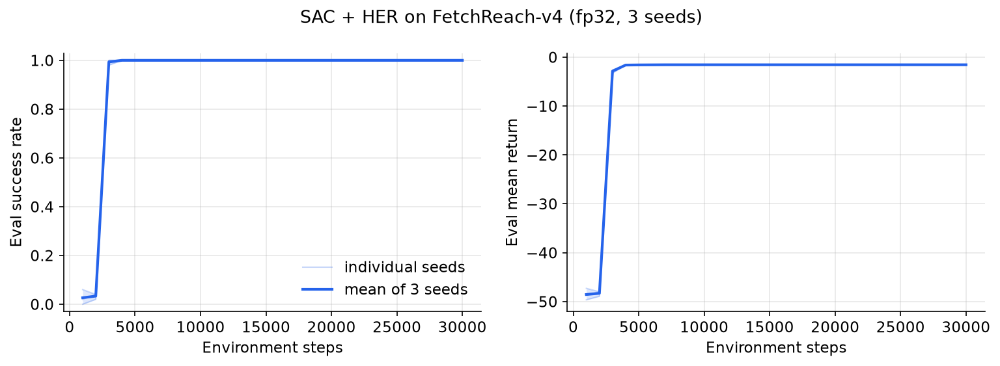
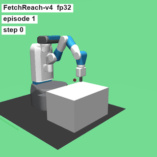

# quantrl-fetch

How few bits does a robot arm policy actually need? This project trains reinforcement learning policies for a simulated Fetch robot arm (MuJoCo, via Gymnasium Robotics) and then squeezes the policy's actor network down to low-bit integer precision: 8 bits, then 6, 5, 4, 3, and 2. It compares three ways of getting a low-bit actor (quantize after training, fine-tune with quantization in the loop, or train with quantization from the start) and later asks whether a post-training stage, behavior cloning followed by online post-training, can win back the performance that quantization costs. The motivation is deployment: a policy that runs on a microcontroller or a small accelerator has to live with low-precision arithmetic, and it is worth knowing where that starts to break a closed-loop controller and what it takes to repair it.

**Status:** Phase 0 (setup) and Phase 1 (SAC and HER at fp32 on FetchReach) are done. Phase 2 (FetchPush) and Phase 3 (quantization) are next. CI is written but not yet active (see the roadmap). See [ROADMAP.md](ROADMAP.md).

## Key results

The quantization results are pending. What has been measured so far is the fp32 baseline:

| Task | Precision | Training seeds | Success rate (mean, min to max over seeds) | Mean return | Mean final distance to goal |
| --- | --- | --- | --- | --- | --- |
| FetchReach-v4 | fp32 | 3 | 1.00 (1.00 to 1.00) | -1.54 | 3.1 cm |

Each seed is evaluated with deterministic actions on the same 100 evaluation episodes (fixed environment seeds). Every seed passed 95 percent evaluation success by 3,000 environment steps. Raw numbers: [results/phase1_fetch_reach_fp32_eval.csv](results/phase1_fetch_reach_fp32_eval.csv) and [results/phase1_fetch_reach_fp32_summary.json](results/phase1_fetch_reach_fp32_summary.json).



## Demo

The fp32 FetchReach policy on four evaluation episodes (the red dot is the goal):



A side-by-side clip of an fp32 policy and a low-bit policy, plus the main success-versus-bit-width chart, will go here after Phase 4.

## Method

**Three ways to get a low-bit actor.**

1. Post-training quantization (PTQ): train the actor in fp32, then quantize its weights and activations to N bits. Activation ranges are calibrated on observations collected by running the trained policy.
2. QAT fine-tuning: train in fp32, then keep training the actor with fake quantization in its forward pass so it can adapt to the rounding.
3. QAT from scratch: fake quantization is in the actor for the entire training run.

**The quantizer.** Values are mapped to a symmetric uniform grid: divide by a scale, round to the nearest integer, clamp to the range an N-bit signed integer can hold, and multiply back. Weights use a scale from their largest absolute value (per tensor or per output channel), and activations use a range tracked with an exponential moving average during training and frozen for evaluation. Rounding has zero gradient almost everywhere, so training uses a straight-through estimator that treats rounding as the identity in the backward pass.

**The RL setup.** The agent is Soft Actor-Critic (SAC) with twin Q critics, Polyak-averaged target networks, automatic entropy tuning, and a tanh-squashed Gaussian actor. The Fetch tasks give a sparse reward (success or not), so the replay buffer uses Hindsight Experience Replay (HER) with the future strategy: some stored transitions are relabeled as if the goal had been a position the gripper or object actually reached later in the same episode. Observations, achieved goals, and desired goals are concatenated after running mean and standard deviation normalization with clipping. Only the actor is quantized; the critics stay fp32.

Everything (SAC, HER, the quantizer) is implemented from scratch in PyTorch.

## Quickstart

Requires [uv](https://docs.astral.sh/uv/). uv installs the pinned Python 3.12 automatically.

```bash
git clone https://github.com/m-alan08/quantrl-fetch.git
cd quantrl-fetch
uv sync
uv run pytest -q
```

Train SAC with HER on FetchReach for one seed (about 1.5 minutes on an Apple M5 CPU), then render four evaluation episodes of the trained policy:

```bash
uv run python scripts/train.py --config configs/fetch_reach.json --seed 0
uv run python scripts/make_video.py --checkpoint runs/fetch_reach_fp32_seed0/checkpoint.pt --out videos/fetch_reach_fp32.mp4 --gif videos/fetch_reach_fp32.gif
```

Training writes `runs/fetch_reach_fp32_seed0/` with the resolved config, run metadata (git commit, package versions, seed), a progress CSV, a summary JSON, and the checkpoint. Any config field can be overridden from the command line, for example `--set train.total_steps=5000 sac.batch_size=512`.

If `uv run` reports `No module named 'quantrl'` on macOS, the `.venv` files have picked up the macOS hidden flag, which makes Python skip the editable install. Run `chflags -R nohidden .venv` to fix it ([docs/NOTES.md](docs/NOTES.md) has the details).

## Repository layout

```
src/quantrl/
  algos/     SAC, networks, HER replay buffer, later BC and post-training
  quant/     quantizers, fake-quant layers, PTQ calibration, QAT utilities
  envs/      environment creation and observation normalization
  eval/      deterministic evaluation and bootstrap statistics
  viz/       video rendering and plotting
  utils/     seeding and run metadata
  config.py  dataclass configs
configs/     JSON run configs
scripts/     train, evaluate, sweep, make_video, make_plots
tests/       pytest suite
results/     small metric files (CSV, JSON)
assets/      README clips and charts
docs/        NOTES.md, a plain-language guide to the code
```

## Reproducing results

All runs use CPU with one torch thread, which is bitwise reproducible: rerunning a seed gives identical training curves and identical actor weights. Runtimes below were measured on an Apple M5 (10 cores).

**Phase 1, FetchReach fp32** (config [configs/fetch_reach.json](configs/fetch_reach.json), seeds 0, 1, 2, 30,000 environment steps each):

```bash
uv run python scripts/train.py --config configs/fetch_reach.json --seed 0 1 2
uv run python scripts/evaluate.py --checkpoints runs/fetch_reach_fp32_seed{0,1,2}/checkpoint.pt --out results/phase1_fetch_reach_fp32_eval.csv --summary results/phase1_fetch_reach_fp32_summary.json
uv run python scripts/make_plots.py --runs runs/fetch_reach_fp32_seed{0,1,2} --out assets/fetch_reach_fp32_training.png --title "SAC + HER on FetchReach-v4 (fp32, 3 seeds)" --csv results/phase1_fetch_reach_fp32_progress.csv
uv run python scripts/make_video.py --checkpoint runs/fetch_reach_fp32_seed0/checkpoint.pt --episodes 4 --out assets/fetch_reach_fp32.mp4 --gif assets/fetch_reach_fp32.gif
```

Measured runtime: one seed alone took 90 seconds of training (96 seconds end to end including the final 100-episode evaluation). Three seeds run as parallel processes took 104 to 105 seconds each. Rendering the four-episode video took under 5 seconds. Passing several seeds to one `train.py` call runs them one after another; launching one process per seed runs them in parallel.

## Limitations and caveats

- mujoco is pinned below 3.12 because newer releases break Fetch environment creation in gymnasium-robotics 1.4.2. Details are in [docs/NOTES.md](docs/NOTES.md).
- FetchReach is easy (every seed solves it in about 3,000 steps), so it can only reveal large quantization damage. FetchPush is the harder benchmark.
- Success means ending within 5 cm of the goal, and the trained FetchReach policy ends about 3 cm away on average, so small precision losses can flip successes. Mean final distance is reported alongside success for this reason.
- Three training seeds give a rough estimate of the spread across seeds.
- Quantization here is simulated (fake quantization in fp32 arithmetic). It models the accuracy effect of low-bit weights and activations but does not measure speed or energy on real integer hardware.

## Roadmap

See [ROADMAP.md](ROADMAP.md).

## References and credits

- Haarnoja, Zhou, Abbeel, Levine. Soft Actor-Critic: Off-Policy Maximum Entropy Deep Reinforcement Learning with a Stochastic Actor. ICML 2018. Haarnoja et al. Soft Actor-Critic Algorithms and Applications. 2018.
- Andrychowicz et al. Hindsight Experience Replay. NeurIPS 2017.
- Plappert et al. Multi-Goal Reinforcement Learning: Challenging Robotics Environments and Request for Research. 2018 (the Fetch tasks).
- Krishnan, Lam, Chitlangia, Wan, Barth-Maron, Faust, Reddi. QuaRL: Quantization for Fast and Environmentally Sustainable Reinforcement Learning. TMLR 2022 (earlier versions titled "Quantized Reinforcement Learning"). This project is inspired by QuaRL and its ActorQ system for quantized actors in distributed RL; all code here is my own.
- Bengio, Leonard, Courville. Estimating or Propagating Gradients Through Stochastic Neurons for Conditional Computation. 2013 (the straight-through estimator).
- Jacob et al. Quantization and Training of Neural Networks for Efficient Integer-Arithmetic-Only Inference. CVPR 2018.
- Todorov, Erez, Tassa. MuJoCo: A physics engine for model-based control. IROS 2012. Gymnasium and Gymnasium Robotics from the Farama Foundation.

Released under the MIT License. See [LICENSE](LICENSE).
